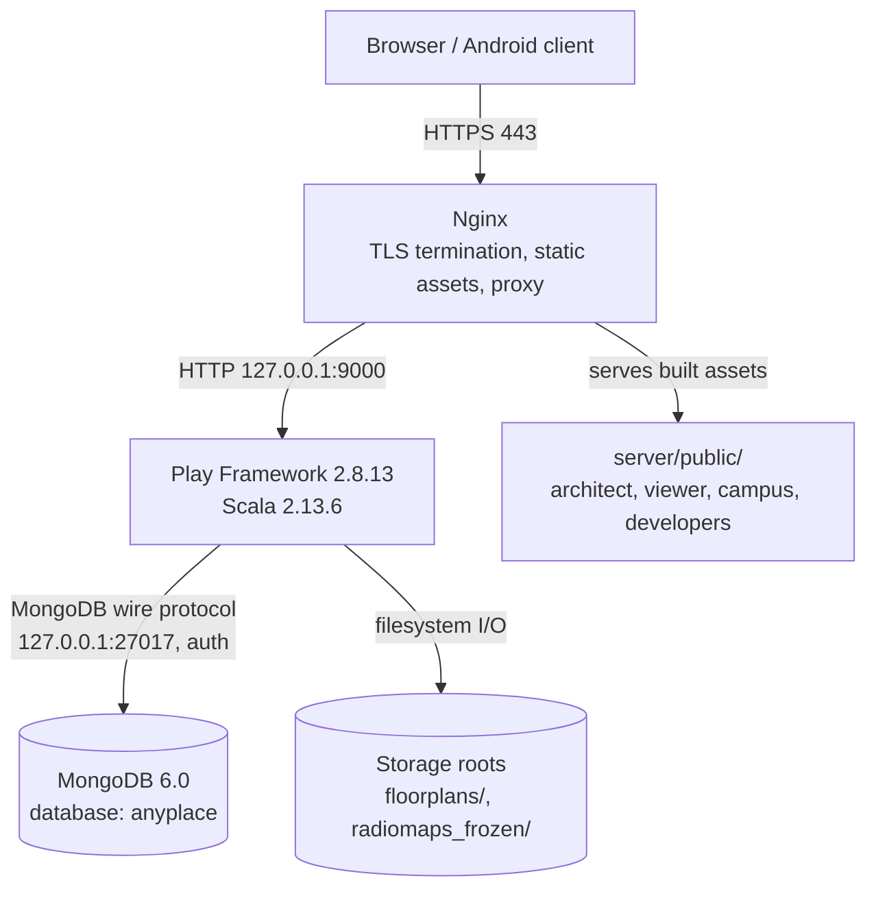
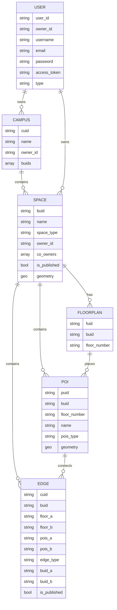

# Architecture

## 1. Runtime topology



The application is a single Play node. Nginx is the only public listener.
MongoDB is reachable only from the host loopback interface.

## 2. Components

| Component | Location | Responsibility |
|---|---|---|
| Play application | `server/app/` | REST API, web app hosting, routing, positioning, tiling orchestration |
| API routes | `server/conf/api.routes`, mounted at `/api` | Version, health, users, spaces, floors, floorplans, POIs, connections, campus, navigation, positioning, radiomaps, heatmaps |
| Legacy Android aliases | `server/conf/api.routes` (`/anyplace/...`) | Compatibility for older Android clients |
| Data access | `server/app/datasources/` | MongoDB access, projections, batched reads, timeouts (`DbAwait`) |
| Domain models | `server/app/models/` | Space, Floor, POI, Connection, Campus, User, Floorplan |
| Controllers | `server/app/controllers/` | Request validation, authorization, response shaping |
| Services | `server/app/services/` | Navigation graph construction and routing |
| Tiler | `server/anyplace_tiler/` | Converts floorplan images into raster tiles |
| Web clients | `clients/web/` | AngularJS/Grunt applications: architect, viewer, campus viewer |
| Built web assets | `server/public/` | Output copied into the staged distribution |
| Operational scripts | root and `server/database/admin/` | Install, lifecycle, backup, restore, dataset seeding |

## 3. Request flow examples

### 3.1 Public space listing

1. Nginx forwards `POST /api/mapping/space/public` to Play.
2. `MapSpaceController.public()` queries published spaces with a projection.
3. The datasource returns only the fields the viewer needs.
4. Play serializes JSON, compresses it, and returns it through Nginx.

### 3.2 POI search

1. The client sends `POST /api/mapping/pois/search` with `cuid`, `buid`, and a
   search term.
2. Input is normalized and capped (length, word count, Greeklish variants).
3. The datasource builds a bounded, indexed MongoDB query.
4. Results are returned with a hard limit; no full-collection scan occurs.

### 3.3 Indoor route

1. The client sends coordinates or POI identifiers.
2. The navigation service loads the relevant floor graph.
3. POIs and edges are loaded in batches, then Dijkstra computes the path.
4. The route is returned in the same shape as the legacy Android API.

### 3.4 Campus route

1. The client sends a campus identifier and two POIs.
2. The service resolves the campus buildings and the outdoor connector graph.
3. Edges are indexed by building pair (`buid_a`, `buid_b`) and edge type.
4. The shortest campus path is returned.

### 3.5 Floorplan upload

1. An authenticated owner or co-owner uploads a floorplan through the architect.
2. The server validates the target building and floor and writes the source image
   under the floorplans root.
3. Tiling is triggered; generated tiles are served statically.
4. Paths are contained within the configured roots; traversal is rejected.

## 4. Data model

MongoDB database: `anyplace`. The schema is document-oriented; the diagram shows
the main references rather than foreign keys.



### 4.1 Collections

| Collection | Purpose |
|---|---|
| `campuses` | Campus metadata and the list of buildings (`buids`). |
| `spaces` | Buildings and vessels; `space_type` is `building` or `vessel`. |
| `floorplans` | Floor metadata per building; the image bytes live on disk. |
| `pois` | Points of interest, including type and coordinates. |
| `edges` | Indoor connections and campus outdoor/stair/elevator edges. |
| `users` | Local and Google accounts, roles, tokens, password hashes. |
| `fingerprintsWifi` | Wi-Fi fingerprint samples used for positioning. |
| `accessPointsWifi` | Cached access point locations. |
| `cFingerprintTime`, `heatmapWifi1..3`, `heatmapWifiTimestamp1..3` | Aggregated heatmap data. |

### 4.2 Indexes

Index creation is idempotent and lives in `server/database/init_schema.js`.
Important indexes:

- `users`: unique `username`, `email`, `owner_id`, `access_token`; partial unique
  index enforcing a single `type: "admin"`; `user_id`.
- `spaces`: unique `buid`; `owner_id`; `co_owners`; `is_published`; 2dsphere
  `geometry`.
- `campuses`: unique `cuid`; `owner_id`; `buids`.
- `floorplans`: unique `fuid`; `{buid, floor_number}`.
- `pois`: unique `puid`; `{buid, floor_number}`; `{buid, pois_type}`; 2dsphere
  `geometry`.
- `edges`: `{buid, floor_a}`; `{buid, is_published}`; `{pois_a, pois_b}`;
  `{edge_type, buid_a, buid_b}`; unique sparse `cuid`.
- `fingerprintsWifi`: `{buid, floor}`; `{MAC, rss}`; 2dsphere `geometry`.

## 5. Storage layout

```text
/opt/anyplace/
  server/target/universal/stage/     staged Play distribution
  floorplans/<buid>/fl_<n>/fl_<n>    floorplan source images
  floorplans/<buid>/fl_<n>/tiles/    generated tiles (not committed)
  radiomaps_frozen/                  Wi-Fi radiomap data
  RUNNING_PID                        removed on start; never a restart blocker
```

Repository seed data:

```text
server/database/dump/anyplace.archive.gz    committed MongoDB snapshot
server/database/dump/VERSION.txt            snapshot description
server/database/floorplans/<buid>/...       committed floorplan sources
server/database/init_schema.js              idempotent collections and indexes
```

## 6. Security model

- **Network**: only Nginx is public. Play binds loopback. MongoDB binds
  loopback and requires authentication.
- **Transport**: TLS terminates at Nginx or the campus gateway; confirm the mode in `docs/deploy/PRODUCTION_PREP_5.0.0.md` before configuring either.
- **Secrets**: supplied by `/etc/anyplace/anyplace.env` (mode `0600`). The unit
  reads `APPLICATION_SECRET` and the `MONGODB_*` variables from it.
- **CORS**: restricted to the configured public origin.
- **Authentication**: bearer access tokens; per-request token lookup is indexed.
- **Passwords**: PBKDF2-HMAC-SHA256 with per-user salt. Legacy hashes verify but
  are never issued.
- **Authorization**: owner, co-owner, moderator, and administrator checks on
  mutating mapping endpoints.
- **Input handling**: bounded search terms and result sizes; JSON body limits.
- **Filesystem**: floorplan and tile paths are normalized and contained within
  their roots.
- **Errors**: API responses carry generic messages; internal details stay in
  logs.
- **Headers**: security headers filter is enabled globally.

## 7. Scaling notes

- The application is stateless apart from local caches; multiple Play instances
  could run behind Nginx if the session model and tile generation are revisited.
- MongoDB is the first scaling boundary. The current indexes cover the hot
  read paths; a replica set would be required for database high availability.
- Tile generation is CPU and disk intensive; schedule bulk imports outside peak
  hours.
- Floorplan and tile caching reduces disk reads for repeat views.
